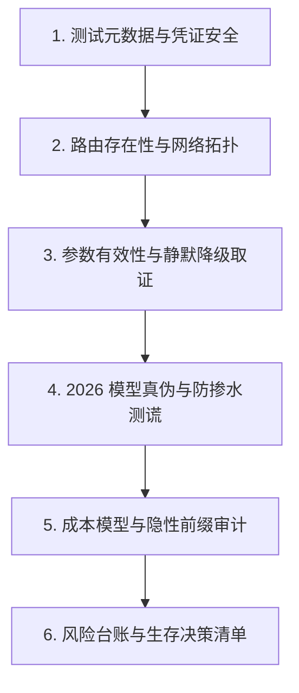

# 工业级 AI API 黑盒兼容性与真实性测试报告规范与模板

> **适用范围**：第三方 AI API 中转网关、模型服务商兼容层、私有化网关逆向验证与选型取证。  
> **编写目标**：杜绝盲目看状态码（HTTP 200）的浅层测试，建立具备法务与技术双重证明力的闭环测试报告。

---

## 报告标准架构体系（6 大核心模块）

一份达到工业级权威水准的技术测试报告，必须完整覆盖以下 6 大模块：



---

## 模块一：测试元数据与严谨性声明（立信之本）

必须在报告首页明确界定测试边界、环境条件与安全约束，杜绝主观臆测。

```markdown
### 1.1 基础元数据
- **测试目标**：`https://example-api.com`（关联域名、机房归属及 CDN 代理情况）
- **测试周期**：2026-XX-XX 00:00 UTC 至 2026-XX-XX 00:00 UTC
- **测试工具**：Python 3.10+ 标准库 (无第三方缓存污染)、curl、OpenSSL
- **调用总计**：X 次计费调用（约 X 万 tokens）+ Y 次零成本路径探测，总开销约 $X.XX
- **凭据生命周期**：测试使用的所有 API Key 均从受控环境注入，取证完成后已全量撤销重置。

### 1.2 证据等级定义（Evidence Hierarchy）
- **[A 级]（核心物证）**：持有完整的原始 HTTP 请求报文、响应头、响应体哈希（SHA-256）及精确毫秒级时间戳；
- **[B 级]（静态特征）**：公开配置接口返回、前端打包 Bundle 静态解析、DNS/RDAP 记录；
- **[C 级 / 推断]**：基于多条实测现象推导得出的结论，明确注明未进行单点突破证实。
```

---

## 模块二：路由存在性全图与五层拒绝阶梯

全面摸清网关对不同协议和路径的响应行为，识别静态 SPA 兜底陷阱。

```markdown
### 2.1 路由总账清单
| 路由路径 | 请求方法 | 鉴权要求 | 实测状态 | 响应类型与行为判定 |
|---|---|---|---|---|
| `/v1/chat/completions` | POST | Bearer / x-api-key | 200 OK | 标准 OpenAI 格式返回 |
| `/v1/responses` | POST | Bearer | 200 OK | OpenAI Responses API（Codex 链路） |
| `/v1/messages` | POST | x-api-key | 200 OK | Anthropic 格式，支持流式 |
| `/v1/audio/speech` | POST | - | 404 Not Found | Gin 裸路由未挂载，TTS 彻底缺失 |
| `/v1/dashboard/billing/*` | GET | - | 200 HTML | **前端 SPA 兜底陷阱**（返回 index.html，非 API） |

### 2.2 网关拒绝阶梯分析
1. **第 1 层（Gin 路由树）**：未注册路径直接返回纯文本 `404 page not found`；
2. **第 2 层（网关鉴权中间件）**：缺少凭据返回 `401 {"code":"API_KEY_REQUIRED"}`；
3. **第 3 层（载荷格式校验）**：空 body 或 JSON 语法错误返回 `400 {"code":"BAD_BODY"}`；
4. **第 4 层（平台门锁）**：请求平台不匹配返回 `400 platform is not gemini`；
5. **第 5 层（模型路由门禁）**：模型不在该 Key 所属分组返回 `404 model_not_found`。
```

---

## 模块三：参数有效性与“静默降级”专项取证

**核心原则**：HTTP 200 不等于成功，必须使用 **“暗号埋入与回传校验法（Canary Probing）”** 确认上游是否真正执行了指令。

```markdown
### 3.1 关键能力取证矩阵
| 测试能力项 | 探针载荷设计（下套方式） | 预期合格响应 | 实际捕获响应 | 判定结论 | 证据级 |
|---|---|---|---|---|---|
| **PDF 附件支持** | 在 Prompt 附加 base64 PDF，正文包含唯一随机字符串，要求复述 | 准确复述该随机字符串 | 返回 200，模型回复“请把文档发我” | **静默丢弃** | A 级 |
| **音频输出模态** | 发送 `modalities: ["audio"]` | Payload 包含音频数据块 | 返回 200，但仅有纯文本，无 audio 字段 | **模态被吞** | A 级 |
| **联网搜索能力** | 携带 `web_search` 工具要求查询当天突发事件 | 工具结果包含最新网页内容摘要 | 工具块存在但 content 为 `[]`，模型盲猜 | **伪联网** | A 级 |
| **`:countTokens`** | 发送最小词组，理论上只返回计数 | 仅返回数字，账户无扣费 | 返回完整文本生成，账户产生扣费 | **名实不符** | A 级 |
```

---

## 模块四：2026 前沿模型真伪与防掺水测谎记录

针对以国内极低成本模型（如字节跳动 `doubao-seed-2-1`、`deepseek-v4`）冒充高价前沿模型（如 `gpt-6-astra`、`claude-sonnet-5`）的专项质检。

**硬性要求（不满足则本模块记为「证据不足」，不得给出通过/不通过结论）**

1. 每条信号必须标注**判别力档位**（A 字段取证 / B 分布指纹 / C 能力埋针 / D 仅参考），并说明是否参与判定；
2. B 段每道探针按类别达到最低重复数（闭集题 n≥8、开放命名题 n≥5），并报告**统计量类型、p 值（置换检验）、Holm 校正后 p、效应量与显著探针数**，不得只报单次结果或一个总分；
3. 判定语言只用三态：**匹配 / 不匹配 / 证据不足**；「不匹配」必须由 A/B/C 档信号支撑；
4. **对照条件必须一致**：同一路径、同一协议入口、同一 UA、同一分组 Key。跨入口的字段差异不得写成「模型被换」；
5. 必须写明**复查计划**。公开审计中存在「前若干次正常、之后才动手脚」的条件触发投递，单次验收通过不构成长期结论；
6. 附原始响应体（脱敏后）作为证据，状态码与截图不作为证据。

```markdown
### 4.1 测谎用例执行记录表
- **检验目标模型**：`gpt-6-astra`（Key 分组：`cc`；入口：`/v1/chat/completions`；UA 固定）
- **对照参考**：官方端点同时段 / 本仓库历史基线 `base_sol.json`
- **执行档位**：A + B（闭集题 n=8、开放题 n≥5，2000 次置换）；C 未执行（原因：费用上限未确认）

#### 用例 1（A 档·高判别力）：响应字段残留取证
- **取证点**：`id` 前缀、顶层骨架字段（`choices` / `content` / `candidates`）、`usage` 字段族、是否透传非本站计费单位、`X-Request-Id` 是否多跳追加（同名响应头须用 `get_all()` 取全量，转字典只留第一个）、标称 JSON 路径是否返回 HTML。**声称的协议族必须与实际请求路径一致**
- **实测**：`id=chatcmpl-8f3…`，`usage` 含 `prompt_tokens/completion_tokens/total_tokens` 与 `cost_in_usd_ticks`
- **判定**：**不匹配（参与判定）** —— 出现上游订阅侧计费单位字段，与「官方按量 API」的声称互斥

#### 用例 2（B 档·中高判别力）：输出分布指纹
- **取证点**：37 道「只回一个词/一个数」探针（含 6 道中文题），闭集题 n≥8 比 Jensen-Shannon 散度、开放命名题 n≥5 比众数占比差；逐道做 2000 次置换检验，Holm 校正后 α=0.05，并设效应量下限（js≥0.15 / 众数占比差≥0.30），**至少 2 道同时成立**才允许「不匹配」
- **实测**：`coin` js=1.000 p=0.0005→校正后 0.019；`rps` js=0.610 p=0.0010→0.037；……共 24/37 道显著且过效应量下限；`zh_animal` 众数占比差 0.88（本次 8/8 全同，基线 2/8）
- **判定**：**不匹配（参与判定）** —— 多探针同时显著且方向一致（随机性被压平），符合「底座被换成低随机性/temperature 归零的廉价模型」，仍须附原始响应体
- **口径失效声明**：本仓库早期版本用「n=5 + js>0.35 + 任一道不合格即定罪」，实测同一模型自采两份分布互比也会误判 21–30/37 道，该口径下的「不匹配」一律作废、不得对外引用

#### 用例 3（C 档·中高判别力）：能力埋针
- **取证点**：附件 canary（暗号写入 PDF 后上传）、长上下文针探并核对 `usage` 是否真按该长度计费
- **实测**：返回 200、无 error，模型回答「请把文档发我」；`prompt_tokens` 未随长度增长
- **判定**：**不匹配（参与判定）** —— 附件被静默丢弃，标称能力未兑现

#### 用例 4（D 档·低判别力，仅记录不参与判定）：自述与首字延迟
- **实测**：强指令下自述「OpenAI / GPT-6」，首字延迟 1.85s
- **说明**：网关会注入约 11 ~ 4,000+ token 的系统前缀，自述内容可由前缀决定；延迟受账号池、缓存与线路支配。**本用例不作为真伪证据**

### 4.2 方法学出处
- LLMmap（训练集成员推断指纹）：arXiv:2407.15847
- 第三方端点造假审计与模型等价检验（MET）：arXiv:2603.01919（该文报告约 45.83% 端点指纹不匹配）
- KBF 知识边界指纹：arXiv:2605.29524
- 实现与成本量级：见本仓库 [`../examples/model_verify.py`](../examples/model_verify.py) 与 [MODEL_VERIFICATION_METHODS.md](MODEL_VERIFICATION_METHODS.md)

### 4.3 禁止写法（出现即判本模块不合格）
- 把「没有出现某厂商关键词」写成「通过」；
- 把「响应很快」写成「不是海外旗舰模型」；
- 依据单一信号写「100% 掺水 / 物理上必然是国内模型」；
- 用跨协议入口的字段差异作为调包证据；
- **用单道探针、小样本的分布差异定罪**：开放命名题（「说一种颜色」）在 n=5 时天然答案互不相同，同一模型自比也会算出 JS≈1.0，这类「不匹配」是自己造出来的假案；
- B 段不报告置换检验 p 值、Holm 校正结果与显著探针数，只给一个「散度 0.41 → 不匹配」的总分。
```

---

## 模块五：成本模型与隐性前缀审计

揭露中转商隐藏在账单背后的真实成本构成。

```markdown
### 5.1 系统前缀注入审计
- **发现**：网关在转发至上游前，暗中注入了不可消除的系统提示词（System Prompt）；
- **实测注入量**：
  - Codex 分组（OpenAI 入口）：≈ 4,114 tokens
  - Free / Grok 分组：≈ 192 tokens
- **计费修正公式**：
  $$\text{真实请求单价} = (\text{用户Prompt} + \text{注入Token}) \times \text{分组倍率} + \text{输出Token} \times \text{分组倍率}$$
- **钱包隔离性**：证实同账号下多把 Key 共享单一钱包余额，不具备独立预算隔离能力。
```

---

## 模块六：风险台账与买方生存建议清单

将技术发现转化为行动准则与风控红线。

```markdown
### 6.1 风险登记台账
- **高风险**：
  1. 图像生成结果存储于第三方公开图床，任何人拿到 URL 皆可访问（严禁传隐私）；
  2. 无人工申诉与退款渠道，单方面免责条款。
- **中风险**：
  1. 部分分组上游账号池耗尽（全报 502/403）；
  2. `:countTokens` 虚假计数并强行计费。

### 6.2 开发者生存法则
1. **即用即测**：配置前先发带暗号的最小 `hello` 测试包；
2. **拒绝盲信**：自动化流程必须自行校验关键字段，不能仅依赖 HTTP 状态码；
3. **资金截断**：小额充值，绝不留存大额余额；
4. **防掺水巡检**：把 `model_verify.py --tier A --run`（A 段字段取证，近零成本）放进每日定时任务或 CI；B 段分布指纹只在月度复查或需要举证时跑一轮（`--tier B --run --compare base.json`）。旧脚本 `model_authenticity_check.py` 属 D 档低判别力反例，**不得用于巡检或下结论**。
```
